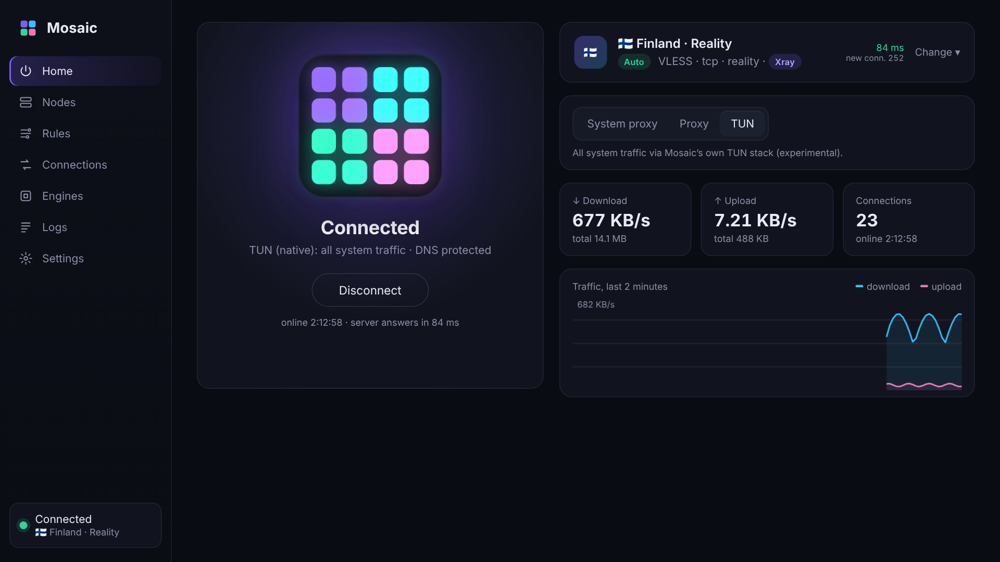
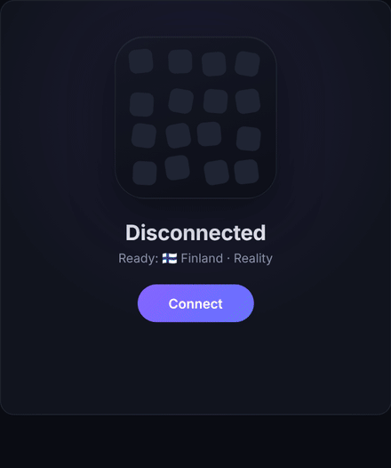
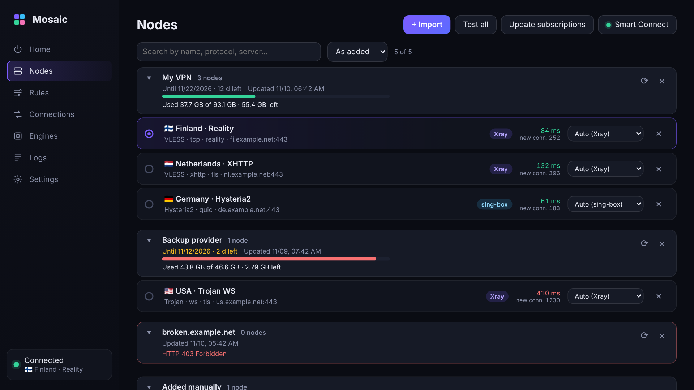
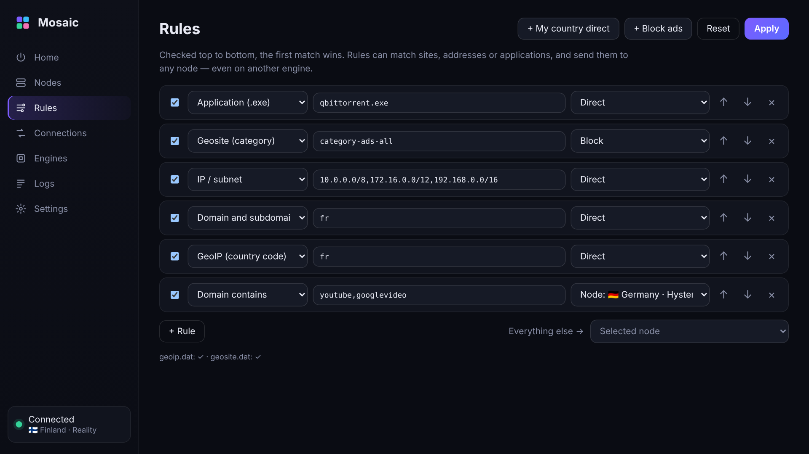
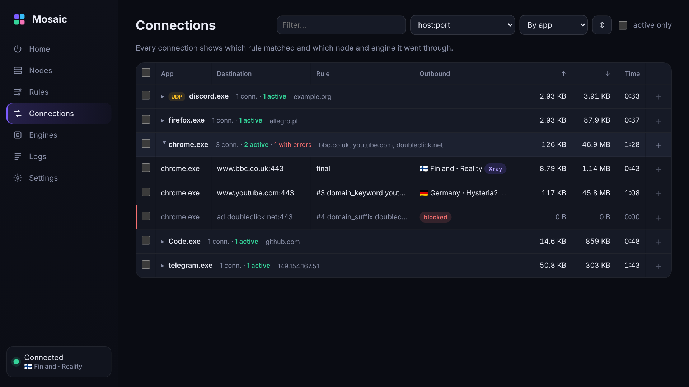
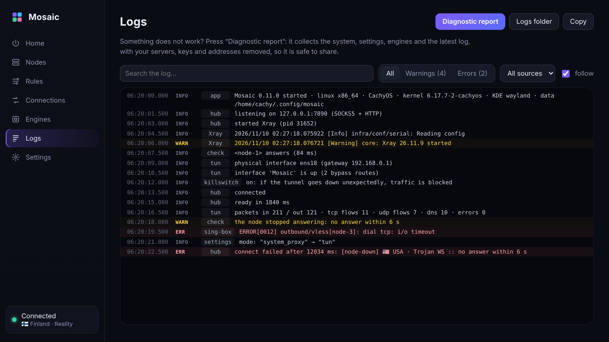
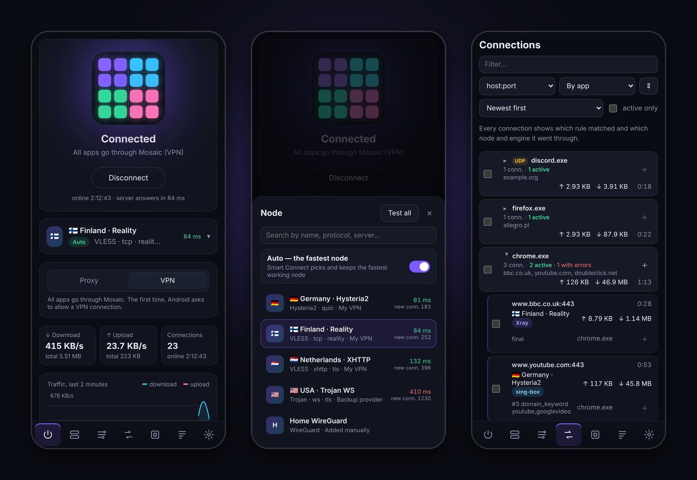
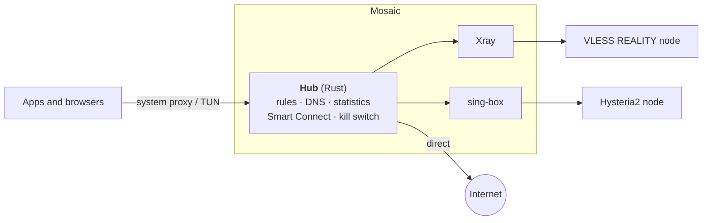

# Mosaic

**One VPN client. Two engines. One set of rules.**

Xray and sing-box nodes side by side, rules that apply instantly,
and a status you can trust — on Windows, Linux and Android.

 

[**Download**](#download) · [Features](#features) · [How it works](#how-it-works) · [FAQ](#faq) · [Русский](README.ru.md)

> [!NOTE]
> Mosaic is a **client**, not a VPN service: it connects to servers you already have — your own or from a
> provider's subscription link. It has no accounts, no ads and no telemetry.

## Why Mosaic

- **Two engines at once.** Every node runs on the engine that supports it best — [Xray](https://github.com/XTLS/Xray-core)
  or [sing-box](https://github.com/SagerNet/sing-box) — and one rule can send YouTube to a Hysteria2 node on sing-box
  while everything else goes through VLESS REALITY on Xray. No “pick a core” switch.
- **Rules apply instantly.** Change a rule, the active node or Smart Connect — open connections keep working,
  new ones follow the new rule. Nothing restarts, the internet never drops.
- **A status that does not lie.** Mosaic checks the node *before* it switches your system over, keeps checking it while
  connected, and shows clearly when the server stops answering — instead of a green “Connected” over a dead tunnel.
- **No leaks.** TUN with DNS leak protection, WebRTC leak protection and an optional kill switch that blocks traffic
  if the tunnel drops.
- **Made to be understood.** Every connection shows the app, the rule that matched and the node it went through.
  When something breaks, one click produces an anonymised diagnostic report.

## Download

| Platform | Package | Notes |
|---|---|---|
| **Windows** 10 / 11 x64 | `Mosaic_<version>_x64-setup.exe` | Installer, no admin needed to install. A portable `.zip` is next to it. |
| **Linux** x64 | `.deb` · `.rpm` · `.AppImage` | TUN asks for your password once; Mosaic itself never runs as root. |
| **Android** 8.0+ | `Mosaic_<version>_android-arm64.apk` | VPN mode, per-app routing, QR import, Quick Settings tile. |

**→ [Latest release](https://github.com/LoopCh/mosaic/releases/latest)** · every file has a SHA-256 in `SHA256SUMS`.

> [!TIP]
> Windows SmartScreen may warn about an unknown publisher: the builds are not code-signed yet. Choose
> *More info → Run anyway*, or check the file against `SHA256SUMS` first. macOS and iOS are planned.

## Quick start

1. **Install** Mosaic and open it.
2. **Add your servers** on *Nodes → Import*: paste share links (`vless://`, `vmess://`, `trojan://`, `ss://`,
   `hysteria2://`, `tuic://`, `wireguard://`), a subscription URL, a Clash / mihomo YAML or a sing-box JSON config —
   or scan a QR code on Android.
3. **Connect** on *Home*. Pick a node by hand or turn on **Auto** (Smart Connect) to keep the fastest working one.

 The mosaic assembles step by step while connecting: engines → checking the node → routing → DNS.

### Three ways to connect

| Mode | What goes through Mosaic | When to use |
|---|---|---|
| **System proxy** | Browsers and apps that follow the system proxy settings | Everyday browsing; no admin rights needed |
| **Proxy** | Only apps you point at `127.0.0.1:7890` (SOCKS5 + HTTP) | Selected apps, or sharing the proxy with your LAN |
| **TUN / VPN** | All traffic of all apps, games included | Full protection: DNS and WebRTC leak protection, kill switch |

## Features

### Nodes and subscriptions

Subscriptions are grouped with what the provider tells about them: traffic used and left, expiry date, last update.
Sort by latency, test all nodes at once, search, and choose the engine per node — or leave it on *Auto*.

### Rules

Domains, domain keywords, IP ranges, **GeoIP / Geosite** categories, ports and **applications** — each sent
*direct*, *blocked*, through the selected node or through any specific node. One click adds “my country direct”
or an ad-blocking list. Rules are checked top to bottom and applied the moment you press *Apply*.

### Connections

Live connections grouped by app, domain, rule or outbound, with traffic, errors and the node and engine each one
used. Select one, a whole group or several, and turn them into a rule in two clicks.

### Logs and diagnostics

Levels, sources, search and filters for warnings and errors. *Diagnostic report* collects the system, status,
engines, settings and the latest log — with node names, servers, keys, subscription URLs and public IP addresses
removed — so it is safe to attach to an issue.

### On your phone

The same app on Android: VPN mode with per-app routing (all / all except / only selected apps), import from the
clipboard or a QR code, a Quick Settings tile, connect on boot and the system's Always-on VPN.

<b>Everything else</b>

- **Smart Connect** — checks the active node every 20 s and all nodes every 3 min; switches instantly when the
  active one fails or a clearly faster one appears.
- **Honest connect** — the node is tested through its engine before the system is switched; if it does not answer,
  Mosaic does not connect (or, with Smart Connect, takes the fastest node that does).
- **Kill switch** (TUN) — Windows: persistent firewall filters; Linux (own TUN stack): the tunnel interface stays and
  swallows traffic; Android: the system's “Block connections without VPN”.
- **DNS leak protection** (Windows TUN) — DNS outside the tunnel is blocked; Mosaic refuses to connect if it cannot verify it.
- **WebRTC leak protection** — STUN requests always go through the node, even for sites with a *Direct* rule.
- **Two TUN stacks** — Mosaic's own, written in Rust (always on Android), or the sing-box TUN adapter.
- **Subscriptions** refresh on a schedule; titles, traffic and expiry come from the provider's headers.
- **Engine updates** from GitHub with SHA-256 verification and automatic rollback.
- **Tray** with node switching; the icon is grey when off, amber when the server does not answer, colourful when connected.
- **LAN sharing** of the local proxy, autostart, start minimised, interface in English and Russian.
- **CLI** (`mosaic-cli`) for servers and scripts.

## Supported

| | |
|---|---|
| **Protocols** | VLESS (incl. REALITY, XTLS Vision), VMess, Trojan, Shadowsocks, Hysteria2, TUIC, WireGuard |
| **Transports** | TCP, WebSocket, gRPC, HTTPUpgrade, XHTTP · Hysteria2 and TUIC run over QUIC |
| **Import** | Share links, base64 subscriptions, Clash / mihomo YAML, sing-box JSON, QR codes (Android) |
| **Engines** | Xray-core and sing-box, chosen per node automatically or by hand |
| **Platforms** | Windows 10/11 x64 · Linux x64 (deb, rpm, AppImage) · Android 8.0+ arm64 |

## How it works

All decisions are made in one small Rust **hub**: it receives every connection, matches the rules, resolves DNS,
counts traffic and picks the outbound. The engines only carry traffic to servers — each node is a separate local
SOCKS inbound on the engine that supports it. Because the routing table is swapped atomically, a rule change
takes effect for the next connection without restarting anything.

Details: [architecture and tools](docs/ARCHITECTURE.md) · [project history and plans](docs/PROJECT.md) (Russian).

## Privacy

- No accounts, telemetry or analytics. Mosaic contacts only your servers and subscriptions, the latency test URL
  (`http://www.gstatic.com/generate_204` by default, changeable) and GitHub — for update checks, which can be turned off.
- Everything is stored locally: `%APPDATA%\Mosaic` on Windows, `~/.config/mosaic` on Linux, app storage on Android.
- Diagnostic reports are anonymised before they leave the app.

## FAQ

<b>Do I need my own server?</b>

Yes. Mosaic is a client: it needs servers to connect to — your own (for example Xray or sing-box on a VPS) or a
subscription link from a provider that offers VLESS, Trojan, Hysteria2 and similar protocols.

<b>Which mode should I choose?</b>

*System proxy* is enough for browsing. Use *TUN* (*VPN* on Android) when games or apps ignore the proxy, or when you
want leak protection and the kill switch. *Proxy* only opens a local SOCKS5/HTTP port for apps you configure yourself.

<b>Why two engines?</b>

Xray and sing-box support different protocols and transports, and each is better at some of them. Mosaic picks
the engine per node, so you never have to choose a “core” and lose half of your nodes.

<b>TUN does not start</b>

- **Windows:** TUN needs Mosaic to run as administrator.
- **Linux:** the first time, the system asks for your password once. If a firewall (ufw, firewalld) is active,
  allow the `Mosaic` interface, e.g. `sudo ufw allow in on Mosaic`.
- **Everywhere:** open *Logs* — the last lines usually say what is wrong.

<b>The internet is blocked after Mosaic closed</b>

That is the kill switch doing its job: the tunnel went down without you disconnecting. Open Mosaic and press
*Connect* or *Unblock the internet*. If Mosaic cannot start: run `mosaic.exe --unblock` as administrator on
Windows, or `sudo ip link del Mosaic` on Linux.

<b>Something does not work — how do I report it?</b>

Open *Logs → Diagnostic report*. It is saved to *Downloads* and copied to the clipboard (on Android it opens the
share menu). Attach it to a [new issue](https://github.com/LoopCh/mosaic/issues/new/choose): servers, keys and
addresses are already removed from it.

## Roadmap

- [x] Windows, Linux, Android
- [x] Own TUN stack, instant rules, Smart Connect
- [x] Kill switch, DNS and WebRTC leak protection
- [x] Clash / sing-box import, subscription info, grouped connections, diagnostics
- [ ] Encrypted DNS (DoH / DoT) and per-domain DNS
- [ ] Rule profiles and actions by Wi-Fi network
- [ ] Remote rule sets, app picker on desktop, settings backup, node QR codes
- [ ] Signed Windows builds, store releases
- [ ] macOS

## Building from source

See [docs/BUILDING.md](docs/BUILDING.md) — Windows, Linux, Android, CLI and releases.
What changed in every version: [CHANGELOG.md](CHANGELOG.md).

## Acknowledgements

Mosaic stands on [Xray-core](https://github.com/XTLS/Xray-core), [sing-box](https://github.com/SagerNet/sing-box),
[Tauri](https://tauri.app), [Wintun](https://www.wintun.net) and [ipstack](https://github.com/narrowlink/ipstack).

## License

[GPL-3.0-or-later](LICENSE). Xray-core and sing-box are distributed under their own licenses.
