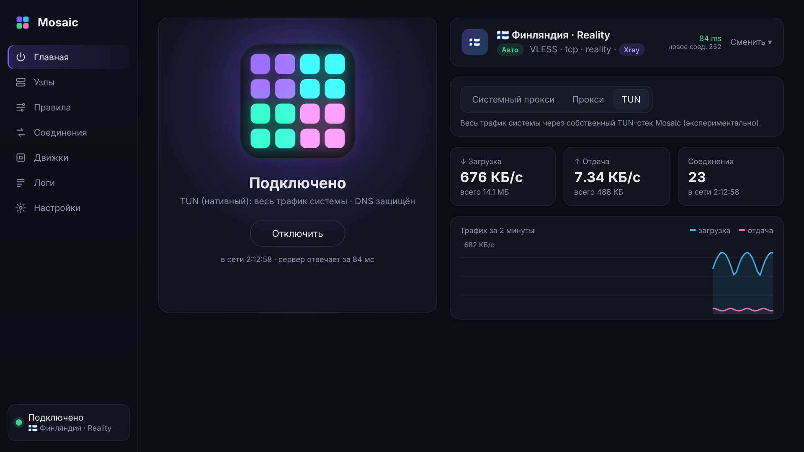
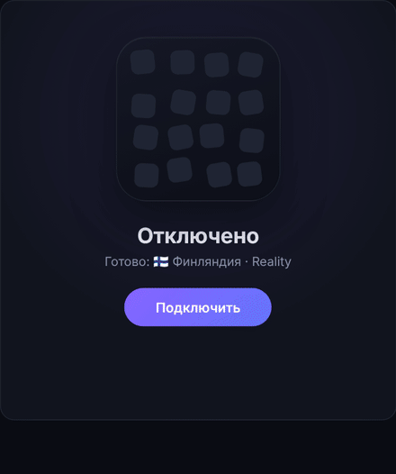
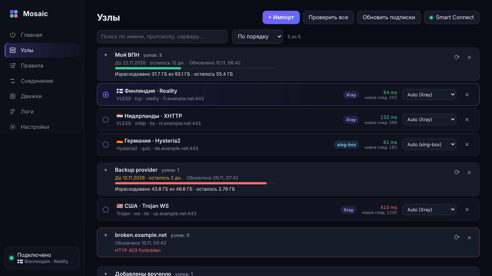
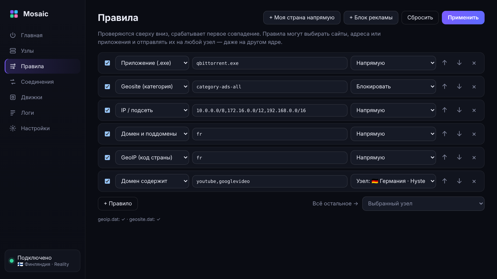
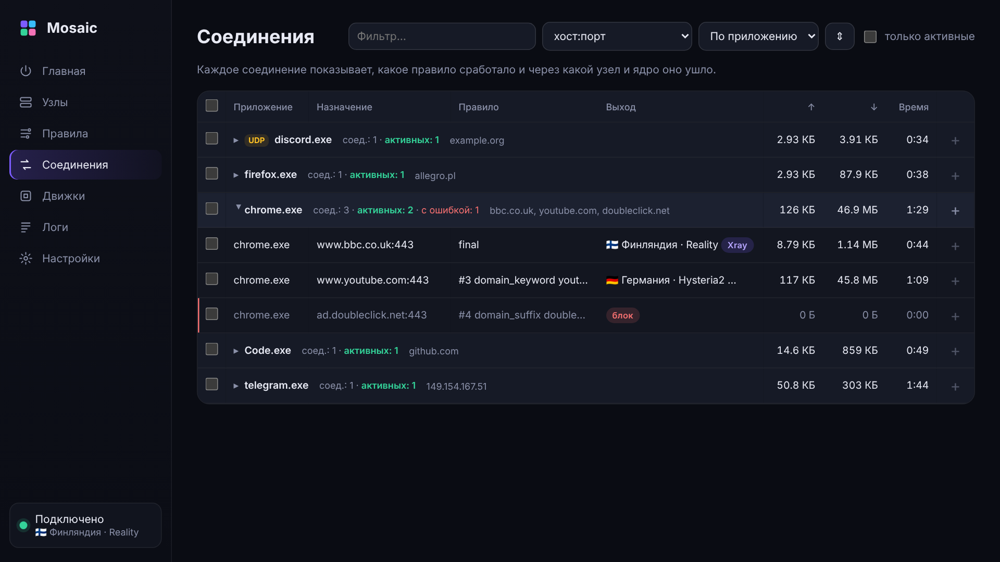
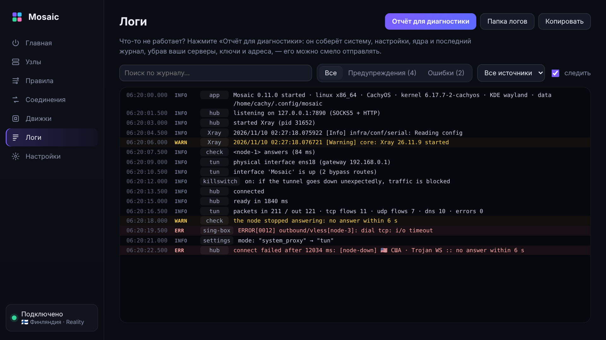
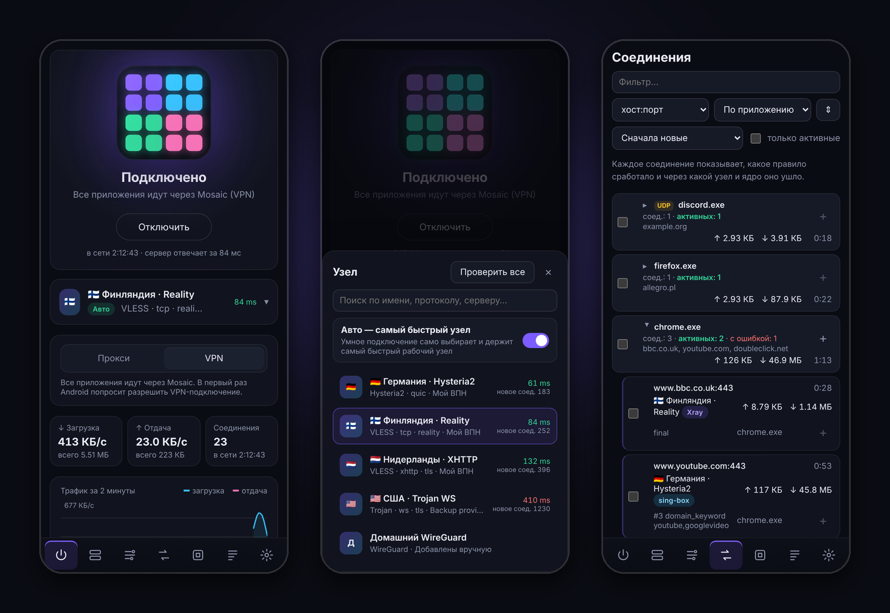
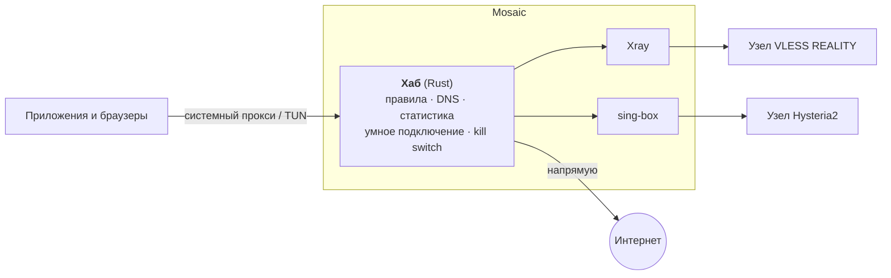

# Mosaic

**Один VPN-клиент. Два ядра. Одни правила.**

Узлы Xray и sing-box рядом, правила применяются мгновенно,
а статусу можно верить — на Windows, Linux и Android.

[**Скачать**](#скачать) · [Возможности](#возможности) · [Как устроено](#как-устроено) · [Вопросы](#вопросы-и-ответы) · [English](README.md)

> [!NOTE]
> Mosaic — это **клиент**, а не VPN-сервис: он подключается к серверам, которые у вас уже есть, — своим или из
> ссылки-подписки провайдера. Без аккаунтов, рекламы и телеметрии.

## Чем Mosaic отличается

- **Два ядра одновременно.** Каждый узел работает на том ядре, которое поддерживает его лучше, —
  [Xray](https://github.com/XTLS/Xray-core) или [sing-box](https://github.com/SagerNet/sing-box). Одно правило может
  отправить YouTube на узел Hysteria2 через sing-box, а всё остальное — через VLESS REALITY на Xray. Переключателя
  «выберите ядро» нет.
- **Правила применяются мгновенно.** Меняете правило, активный узел или умное подключение — открытые соединения
  продолжают работать, новые идут по-новому. Ничего не перезапускается, интернет не пропадает.
- **Статус не обманывает.** Mosaic проверяет узел *до* того, как переключить систему, продолжает проверять его во
  время работы и прямо показывает, если сервер перестал отвечать, — вместо зелёного «Подключено» над мёртвым туннелем.
- **Без утечек.** TUN с защитой от утечек DNS и WebRTC и kill switch, который блокирует трафик при обрыве туннеля.
- **Понятно, что происходит.** У каждого соединения видно приложение, сработавшее правило и узел. Если что-то
  сломалось — одна кнопка собирает обезличенный отчёт для диагностики.

## Скачать

| Платформа | Файл | Примечание |
|---|---|---|
| **Windows** 10 / 11 x64 | `Mosaic_<версия>_x64-setup.exe` | Установщик, права администратора для установки не нужны. Рядом — портативный `.zip`. |
| **Linux** x64 | `.deb` · `.rpm` · `.AppImage` | Для TUN система один раз спросит пароль; сам Mosaic не работает от root. |
| **Android** 8.0+ | `Mosaic_<версия>_android-arm64.apk` | Режим VPN, выбор приложений, импорт по QR, плитка в быстрых настройках. |

**→ [Последний релиз](https://github.com/LoopCh/mosaic/releases/latest)** · контрольные суммы SHA-256 — в `SHA256SUMS`.

> [!TIP]
> SmartScreen в Windows может предупредить о неизвестном издателе: сборки пока не подписаны. Нажмите
> *Подробнее → Выполнить в любом случае* или сначала сверьте файл с `SHA256SUMS`. macOS и iOS — в планах.

## Быстрый старт

1. **Установите** Mosaic и откройте его.
2. **Добавьте серверы** во вкладке *Узлы → Импорт*: вставьте ссылки (`vless://`, `vmess://`, `trojan://`, `ss://`,
   `hysteria2://`, `tuic://`, `wireguard://`), адрес подписки, конфиг Clash / mihomo (YAML) или sing-box (JSON) —
   или отсканируйте QR-код на Android.
3. **Подключитесь** на *Главной*. Выберите узел сами или включите **Авто** (умное подключение) — Mosaic будет держать
   самый быстрый рабочий.

 Мозаика собирается по шагам подключения: ядра → проверка узла → маршрутизация → DNS.

### Три режима

| Режим | Что идёт через Mosaic | Когда выбирать |
|---|---|---|
| **Системный прокси** | Браузеры и приложения, которые следуют системным настройкам прокси | Обычный веб; права администратора не нужны |
| **Прокси** | Только приложения, где вы укажете `127.0.0.1:7890` (SOCKS5 + HTTP) | Отдельные программы или раздача прокси в локальную сеть |
| **TUN / VPN** | Весь трафик всех приложений, включая игры | Полная защита: от утечек DNS и WebRTC, kill switch |

## Возможности

### Узлы и подписки

Подписки сгруппированы вместе с тем, что о них сообщает провайдер: израсходованный и оставшийся трафик, срок
действия, время обновления. Сортировка по задержке, проверка всех узлов разом, поиск и выбор ядра для каждого узла —
или *Авто*.

### Правила

Домены, слова в домене, IP-подсети, категории **GeoIP / Geosite**, порты и **приложения** — напрямую, в блок, через
выбранный узел или через любой конкретный узел. Одна кнопка добавляет «моя страна напрямую» или список рекламы.
Правила проверяются сверху вниз и начинают действовать в момент нажатия *Применить*.

### Соединения

Живые соединения с группировкой по приложению, домену, правилу или выходу — с трафиком, ошибками, узлом и ядром.
Выберите одно, целую группу или несколько — и превратите их в правило в два нажатия.

### Логи и диагностика

Уровни, источники, поиск и фильтры предупреждений и ошибок. *Отчёт для диагностики* собирает систему, статус, ядра,
настройки и последний журнал — без названий узлов, серверов, ключей, адресов подписок и публичных IP, — так что его
можно приложить к issue.

### На телефоне

То же приложение на Android: режим VPN с выбором приложений (все / все, кроме / только выбранные), импорт из буфера
обмена и по QR, плитка в быстрых настройках, подключение после загрузки и системная «Постоянная VPN».

<b>И ещё</b>

- **Умное подключение** — проверяет активный узел каждые 20 с, все узлы — раз в 3 минуты; мгновенно переключается,
  если активный перестал отвечать или появился заметно более быстрый.
- **Честное подключение** — узел проверяется через своё ядро до переключения системы; не ответил — Mosaic не
  подключается (а с умным подключением берёт самый быстрый из ответивших).
- **Kill switch** (TUN) — Windows: постоянные фильтры брандмауэра; Linux (свой TUN-стек): интерфейс туннеля
  остаётся и забирает трафик; Android: системное «Блокировать соединения без VPN».
- **Защита от утечек DNS** (Windows, TUN) — DNS в обход туннеля блокируется; если проверить это не удалось, Mosaic не подключается.
- **Защита от утечки WebRTC** — STUN-запросы всегда идут через узел, даже для сайтов с правилом *Напрямую*.
- **Два TUN-стека** — собственный, на Rust (на Android всегда), или адаптер sing-box.
- **Подписки** обновляются по расписанию; название, трафик и срок берутся из заголовков провайдера.
- **Обновление ядер** с GitHub с проверкой SHA-256 и автоматическим откатом.
- **Трей** с выбором узла; значок серый — отключено, жёлтый — сервер не отвечает, цветной — подключено.
- **Раздача прокси в локальную сеть**, автозапуск, запуск свёрнутым, интерфейс на русском и английском.
- **CLI** (`mosaic-cli`) для серверов и скриптов.

## Поддерживается

| | |
|---|---|
| **Протоколы** | VLESS (включая REALITY, XTLS Vision), VMess, Trojan, Shadowsocks, Hysteria2, TUIC, WireGuard, SOCKS5, HTTP(S)-прокси (с логином) |
| **Транспорты** | TCP, WebSocket, gRPC, HTTPUpgrade, XHTTP · Hysteria2 и TUIC работают поверх QUIC |
| **Импорт** | Ссылки, подписки в base64, Clash / mihomo (YAML), sing-box (JSON), QR-коды (Android) |
| **Ядра** | Xray-core и sing-box — для каждого узла автоматически или вручную |
| **Платформы** | Windows 10/11 x64 · Linux x64 (deb, rpm, AppImage) · Android 8.0+ arm64 |

## Как устроено

Все решения принимает небольшой **хаб** на Rust: он получает каждое соединение, сверяет правила, разрешает DNS,
считает трафик и выбирает выход. Ядра только доставляют трафик до серверов — каждый узел это отдельный локальный
SOCKS-вход на том ядре, которое его поддерживает. Таблица маршрутизации подменяется атомарно, поэтому изменение
правила действует уже для следующего соединения, без перезапусков.

Подробнее: [архитектура и инструменты](docs/ARCHITECTURE.md) · [история проекта и планы](docs/PROJECT.md).

## Приватность

- Никаких аккаунтов, телеметрии и аналитики. Mosaic обращается только к вашим серверам и подпискам, к адресу теста
  задержки (по умолчанию `http://www.gstatic.com/generate_204`, можно поменять) и к GitHub — за проверкой обновлений,
  которую можно выключить.
- Всё хранится локально: `%APPDATA%\Mosaic` в Windows, `~/.config/mosaic` в Linux, хранилище приложения в Android.
- Отчёты для диагностики обезличиваются до того, как покинут приложение.

## Вопросы и ответы

<b>Нужен ли свой сервер?</b>

Да. Mosaic — клиент: ему нужны серверы — свои (например, Xray или sing-box на VPS) или ссылка-подписка от
провайдера, который даёт VLESS, Trojan, Hysteria2 и похожие протоколы.

<b>Какой режим выбрать?</b>

Для браузера достаточно *Системного прокси*. *TUN* (*VPN* на Android) — если игры или приложения не слушаются
прокси или нужна защита от утечек и kill switch. *Прокси* лишь открывает локальный порт SOCKS5/HTTP для программ,
которые вы настроите сами.

<b>Зачем два ядра?</b>

Xray и sing-box поддерживают разные протоколы и транспорты и в чём-то лучше друг друга. Mosaic выбирает ядро для
каждого узла сам, поэтому не нужно выбирать одно «ядро» и терять половину узлов.

<b>TUN не запускается</b>

- **Windows:** для TUN Mosaic нужно запускать от имени администратора.
- **Linux:** в первый раз система один раз спросит пароль. Если работает файрвол (ufw, firewalld), разрешите
  интерфейс `Mosaic`, например `sudo ufw allow in on Mosaic`.
- **Везде:** откройте вкладку *Логи* — последние строки обычно говорят, в чём дело.

<b>После закрытия Mosaic пропал интернет</b>

Это сработал kill switch: туннель пропал не по вашей команде. Откройте Mosaic и нажмите *Подключить* или
*Разблокировать интернет*. Если Mosaic не запускается: в Windows выполните `mosaic.exe --unblock` от администратора,
в Linux — `sudo ip link del Mosaic`.

<b>Что-то не работает — как сообщить?</b>

Откройте *Логи → Отчёт для диагностики*. Он сохранится в *Загрузки* и скопируется в буфер обмена (на Android
откроется меню «Поделиться»). Приложите его к [новому issue](https://github.com/LoopCh/mosaic/issues/new/choose):
серверы, ключи и адреса из него уже убраны.

## Планы

- [x] Windows, Linux, Android
- [x] Собственный TUN-стек, мгновенные правила, умное подключение
- [x] Kill switch, защита от утечек DNS и WebRTC
- [x] Импорт Clash / sing-box, информация о подписке, группировка соединений, диагностика
- [ ] Шифрованный DNS (DoH / DoT) и DNS для отдельных доменов
- [ ] Профили правил и действия по сети Wi-Fi
- [ ] Наборы правил по ссылке, выбор приложений на компьютере, резервная копия настроек, QR-коды узлов
- [ ] Подписанные сборки для Windows, публикация в магазинах
- [ ] macOS

## Сборка из исходников

См. [docs/BUILDING.md](docs/BUILDING.md) — Windows, Linux, Android, CLI и релизы.
Что менялось в каждой версии: [CHANGELOG.md](CHANGELOG.md).

## Благодарности

Mosaic построен на [Xray-core](https://github.com/XTLS/Xray-core), [sing-box](https://github.com/SagerNet/sing-box),
[Tauri](https://tauri.app), [Wintun](https://www.wintun.net) и [ipstack](https://github.com/narrowlink/ipstack).

## Лицензия

[GPL-3.0-or-later](LICENSE). Xray-core и sing-box распространяются под своими лицензиями.
